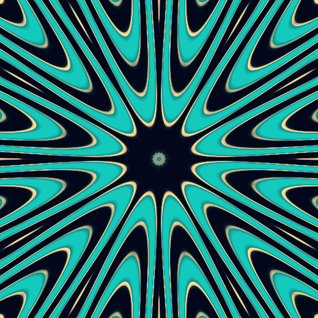

# PRISMA — Caleidoscopio de cristal (IG · S9)



> Doce sectores reflejados, contornos dorados y tonos turquesa sobre azul marino. El efecto se calcula por fragmento en GLSL, sin texturas ni mallas complejas.

## Visualización

- **Shader para entregar:** [`shader.frag`](shader.frag) (versión explicada), [`shader.min.frag`](shader.min.frag) (versión compacta, **511 bytes**, incluido el salto de línea final).
- **Demostración interactiva:** abrir [`vista-previa.html`](vista-previa.html) en un navegador compatible con WebGL. Se puede pausar, reiniciar y ajustar la velocidad de animación.
- **Editor solicitado:** copiar el contenido de [`shader.frag`](shader.frag) en [The Book of Shaders](https://editor.thebookofshaders.com/). El editor proporciona automáticamente `u_resolution` y `u_time`.

**Nota sobre la vista previa:** el GIF de esta documentación se ha generado evaluando en Python las mismas fórmulas numéricas utilizadas en GLSL; es una ilustración del resultado previsto, no una captura del editor. Antes de entregar, comprueba que el shader se ve correctamente en The Book of Shaders y añade una captura real si resulta oportuno.

## Motivación

Se pretende interpretar visualmente un caleidoscopio con apariencia de vidriera: doce sectores repetidos por reflexión, bandas concéntricas semejantes a pétalos y contornos cálidos que contrastan con un fondo frío. Frente a una combinación indiscriminada de ondas, la composición utiliza una paleta deliberadamente limitada para que se distingan las formas.

## Fundamento y desarrollo

1. **Normalización**. De `gl_FragCoord.xy` se resta el centro de la pantalla y se divide por `min(u_resolution.x, u_resolution.y)` para mantener la proporción del motivo, incluso si el lienzo no es cuadrado.
2. **Espacio polar**. Se calcula el radio `r = length(p)` y el ángulo `a = atan(p.y, p.x)`, añadiendo `u_time/12.` al ángulo para introducir un giro lento.
3. **Simetría**. Se define la apertura `s = π/6`, correspondiente a **12 sectores**. Con `mod(a,s)` y `abs(...)` se pliega cada sector sobre sí mismo, produciendo repetición especular.
4. **Curvas procedimentales**. Se devuelve al plano cartesiano con `q = r * (cos(a), sin(a))`. La función `b = sin(32*q.x + 9*cos(18*q.y-u_time))` genera contornos curvos en forma de pétalos. Otra onda `d` modula el brillo de los bordes.
5. **Material y contornos**. La variable `v = 1 - smoothstep(.12,.27,abs(b))` aísla bandas delgadas próximas a determinados valores de la onda. `mix` combina azul marino y turquesa; sobre esa mezcla se suman contornos dorados, obteniendo un efecto de vidriera.
6. **Animación**. `u_time` altera progresivamente la orientación de los sectores y las ondas internas. Se han elegido coeficientes temporales que permiten que el patrón vuelva aproximadamente al mismo estado tras una vuelta de `2π` segundos.

## Comprobaciones de entrega

- [x] Shader de fragmentos escrito en GLSL ES 1.00.
- [x] Patrón generativo mediante operaciones matemáticas.
- [x] Animación mediante `u_time`.
- [x] Versión compacta de **511 bytes** medida en UTF-8, incluyendo `uniforms` y salto de línea final.
- [ ] Confirmar visualmente su ejecución en el editor de The Book of Shaders.

## Archivos

```text
shader.frag             Shader legible y comentado
shader.min.frag         Shader compacto (511 bytes)
vista-previa.html       Visualización WebGL sin dependencias externas
capturas/
  prisma-poster.png     Ilustración estática calculada desde las fórmulas
  prisma-animado.gif    Ilustración animada calculada desde las fórmulas
```

## Fuentes

- [Guion de la sesión 9, Informática Gráfica (ULPGC)](https://github.com/otsedom/otsedom.github.io/blob/main/IG/S9/README.md), secciones *Shaders de fragmentos*, *Transformaciones*, *Patrones y generativos* y *Tarea*.
- Patricio Gonzalez Vivo y Jen Lowe, [The Book of Shaders](https://thebookofshaders.com/): coordenadas, funciones de forma y patrones procedimentales.
- [Editor de The Book of Shaders](https://editor.thebookofshaders.com/).

El patrón PRISMA constituye una nueva combinación de estas técnicas. El guion S9 no define el formato exacto de envío; deberá comprobarse la vía de entrega del Campus Virtual.
